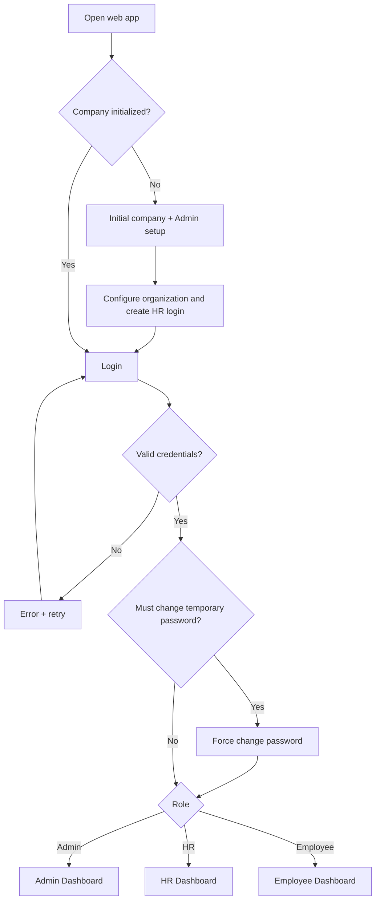
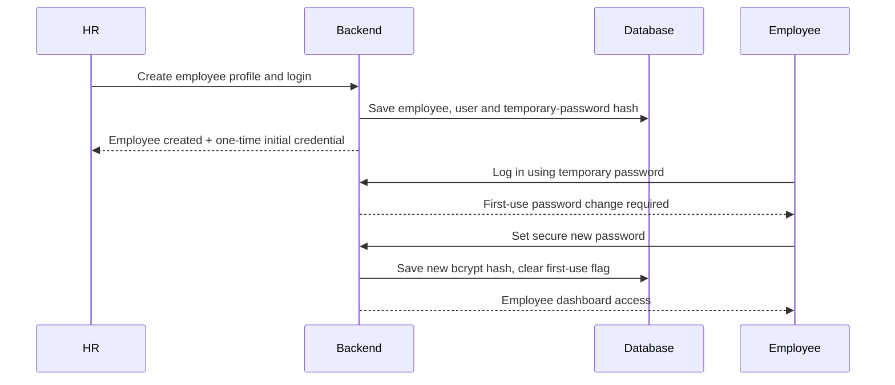
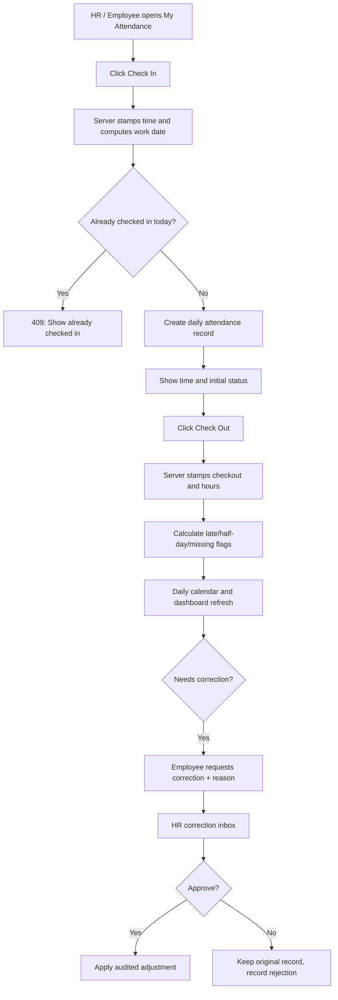
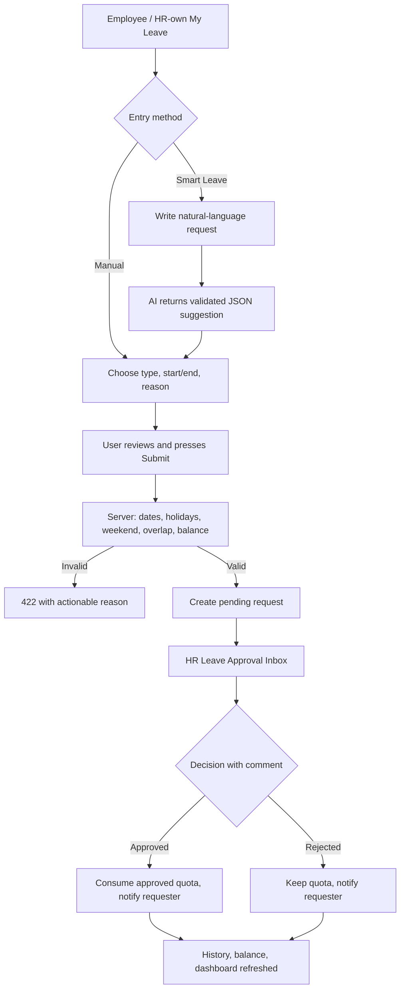
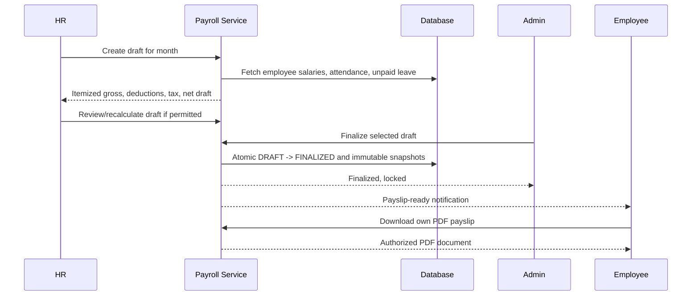

# HCM Lite — App Flow & Screen-to-Screen Journeys

**Status:** Functional navigation blueprint; routes and page naming are **[PROPOSED]** unless indicated **[BRIEF]**.  
**Based on:** Saylani HCM Lite challenge brief, pp. 1–6.  
**Purpose:** Give frontend and backend teams one agreed description of what happens before, during, and after every user action.

## 1. Application flow at a glance

**Data rule [BRIEF]:** On first boot all employees, attendance, leave requests, payroll records and KPI series are empty. No synthetic charts or prepopulated operational widgets.

## 2. Role-specific navigation map [PROPOSED UX grouping]

**Admin sidebar:** Overview | Company Settings | Departments | Designations | Leave Types & Holidays | User Accounts | Employee Directory | Attendance Overview | Leave Overview | Payroll & Finalization | Analytics | Announcements | Audit Log | AI Assistant | My Account.

**HR sidebar:** Overview | Employees | CSV Import/Export | Attendance Board | Correction Inbox | Leave Approvals | My Attendance | My Leave | Salary Structures | Payroll Drafts | Analytics | Announcements | AI Assistant | Notifications | My Account.

**Employee sidebar:** My Dashboard | Check In/Out | My Attendance | Attendance Corrections | My Leave | Smart Leave | My Payslips | My Profile | Announcements | Notifications | AI Assistant | My Account.

**[BRIEF]** menus and dashboards must be distinct, but exact route labels/order are not mandated. Unauthorized pages must return a server-side `403`/concealed `404`, not only disappear from menus.

## 3. Flow A — First-run organization setup

**Actor:** Installer/first Admin. **Precondition:** No initialized company and Admin account.

1. Visitor opens `/setup` and reads an explanation that no company currently exists.
2. Form collects **company name, Admin email, Admin password/confirmation**; validate on client/server. **[BRIEF]** Alternate bootstrap via `ADMIN_EMAIL`/`ADMIN_PASSWORD` environment variables is allowed.
3. On successful atomic setup, user lands on Admin setup checklist/dashboard.
4. Admin edits **office start, grace time, half-day threshold, weekends, office geofence center/radius**, using initial defaults 09:00, 15 minutes, under five hours, Sat/Sun, example 150m. [BRIEF]
5. Admin creates a department, designation, leave types and quotas, and holidays. Initial annual/sick/casual/unpaid policy defaults are available to configure.
6. Admin creates an HR login and gives HR initial sign-in instructions.
7. Setup remains available only through protected Admin settings after initialization.

**Expected outcomes:** Company settings persist; HR login is valid; Employee count remains **0** until HR adds employees.  
**Exceptions:** Duplicate bootstrap attempt denied; incomplete settings show actionable form errors; location GPS permissions are **not required for ordinary web attendance**.

## 4. Flow B — Authentication, first-use reset, and account controls

**Additional actions:** Any role can log out and change password. Admin can create HR logins, reset/deactivate accounts. Disabled users cannot access protected records, even with previously issued sessions. [Proposed explicit enforcement]

**Exception screens:** invalid credentials, disabled account, expired session, password-strength error, first-use requirement not satisfied.

## 5. Flow C — Employee registration and Employee 360

**Actor:** HR. **Input:** employee code, name, email, department, designation, joining date, salary basic and any policy-relevant fields. [BRIEF states job details and salary; specific field list PROPOSED]

1. HR opens Employees → Add Employee.
2. HR selects an existing department/designation, enters personal/job data and salary.
3. Client validates obvious errors; backend validates required fields, unique employee code/email, valid email, known department, ISO dates, positive salary.
4. Backend saves the employee, their initial salary structure and an Employee login in one transaction.
5. HR sees success plus temporary credential handling, not a permanently retrievable plaintext password.
6. Employee appears in directory and Admin/HR counts instantly, with real data only.
7. HR can search/filter/paginate and edit employee records; Admin can view; employee can see own 360 profile and edit **phone/address only**.

**CSV branch:** HR uploads CSV → `Dry run` produces field-level row issues and counts **without writing** → HR fixes file/chooses commit → backend imports validated rows → results summary; HR can export. [BRIEF checklist F08]

**Exceptions:** duplicate code/email; unknown department; salary <=0; row validation; partial import policy **[OPEN]** (proposal: all-or-nothing for committed file to prevent incomplete onboarding).

## 6. Flow D — Web attendance and correction

**Rules [BRIEF]:** default late after 09:15; half-day under 5 hours; missing checkout if check-out absent; absent if no record and no approved leave. Second check-in same day must return HTTP 409.

**Board:** HR/Admin may filter daily activity by date/department. Employee may only inspect own dates.  
**Exception:** A missed checkout remains flagged; employee can't silently rewrite it; use correction request and HR decision.  
**[OPEN]** A check-in with no checkout may be late and missing_checkout simultaneously; see TRD classification decision.

## 7. Flow E — Manual and AI-assisted leave

**Example smart-leave text from the PDF:** "I need next Monday and Tuesday off for my sister's wedding." The AI must compute dates relative to the company's current calendar/time zone, suggest casual leave, and fill but **not submit** the form. [BRIEF]

**Checks:** reject overlapping or over-balance submissions with HTTP 422; skip weekends and public holidays in chargeable leave days. [BRIEF]

**Cancellation:** owner can cancel leave, see balance/history; exact behavior for cancelling *approved past or current leave* is **[OPEN]**. [PROPOSED] Allow pending cancellation immediately; approved future leave cancellation should be policy-guarded and audited.

## 8. Flow F — Monthly payroll + finalization + payslip

**Inputs:** basic salary, HRA 40%, medical 10%, working days, absences, unpaid days, half-days, join/exit dates, specified illustrative tax slabs.  
**Lock rule [BRIEF]:** Admin alone finalizes; no one, including Admin, can edit a finalized run.  
**[OPEN]** An approved correction after finalization must **not** mutate a historical locked payslip automatically.

## 9. Flow G — Dashboards and KPI filters

1. User signs in and opens role-specific dashboard.
2. Dashboard queries its authorized aggregate endpoint (server computes numbers).
3. Admin/HR can change date range and department where applicable; each filter causes a new server aggregation.
4. Show metrics, trends, charts and lists based only on returned rows.
5. Admin/HR presses `Summarize`; backend sends *current KPI JSON* to LLM; displays 3–5 grounded insights labeled AI-generated.
6. On empty database, show `No employees yet`, `No attendance records`, etc. **Never substitute demonstration values**.

**Metrics required [BRIEF]:** headcount, attrition, attendance rate, lateness, absenteeism, leave utilization, gross/net payroll cost and average salary; charts by date/department as specified for roles.

## 10. Flow H — AI conversation and permission checks

**All roles:** user types prompt → `/ai/chat` authenticates and enforces scope → model selects a known tool → backend validates tool args, invokes same domain service as dashboard → tool returns allowed facts → LLM formats readable answer → store AI log, label as AI-generated.

**Judge test cases [BRIEF]:**

- HR: "How many active employees are in [department]?" → matched filtered headcount.
- HR: "Who came late most often this month?" → ranked from actual attendance.
- HR: "What is this month's attendance rate?" → match KPI endpoint.
- Employee: "How many sick leaves do I have left this year?" → own balance.
- Employee: "What is [colleague]'s salary?" → refuse without revealing pay.
- Employee: "I need next Monday and Tuesday off..." → safe, editable leave form suggestion.

**Failure states:** provider timeout 15s; quota ~20 requests/user/hour; invalid smart-leave JSON retry once, then normal leave form; policy unknown → honest 'not provided'. The rest of the app remains usable when AI is unavailable.

## 11. Flow I — Communications and audit

- Admin/HR posts announcement → all three role dashboards show it.
- HR makes leave decision → requester receives in-app notification.
- Admin finalizes payroll → associated employees receive payslip-ready notification.
- System records important creates, changes, decisions and finalizations as `actor`, `action`, `entity`, `before/after` JSON; only Admin can view audit feed. Users cannot edit/delete its entries.

## 12. Page route inventory [PROPOSED]

| Route pattern | Page | Roles |
|---|---|---|
| `/setup` | First-run wizard | Only before initialization |
| `/login`, `/change-password` | Auth | Public / authenticated as appropriate |
| `/admin/*` | Admin shell / dashboard, organization, accounts, audit, analytics | Admin |
| `/hr/*` | HR shell / employee, approvals, attendance, payroll, analytics | HR |
| `/employee/*` | Self-service shell | Employee |
| `/attendance/me` | Personal clock and attendance calendar | HR, Employee |
| `/leave/me` | Own leave requests, balance and smart leave | HR, Employee |
| `/payslips/me` | Employee own payslip PDFs | Employee (HR personal record if supported) |
| `/ai` | Role-aware AI chat | Admin, HR, Employee |
| `/notifications` | My notifications | All |
| `/account` | My profile/credentials | All |
| `*` | Not Found/Forbidden | All |

Route names are **illustrative**. Real user authority comes from JWT + backend service decisions, not URL patterns.

## 13. Universal page states and recovery routes

| State | User experience |
|---|---|
| First install | Guided bootstrap, no dashboard fiction |
| Empty list | Helpful explanation and role-appropriate first action |
| Loading | Visible skeleton/spinner, buttons not double-submittable |
| No access | Clear access denied screen, no leaked record information |
| Form validation | Inline field errors, data preserved |
| Server/offline problem | Retry instructions, existing data not wiped |
| Duplicate check-in (`409`) | Explain previous recorded check-in and show its time |
| Invalid leave (`422`) | Show overlap/balance problem and let user amend dates |
| Pending approval | Badge + timeline; no implied approval |
| Locked payroll | Read-only details; finalize action removed/denied |
| AI provider unavailable | Friendly fallback, ordinary forms stay available |
| No matching chart records | Truthful empty visualization instead of fake chart |

## 14. Flow definition of done

- [ ] Every journey can be followed beginning with **zero employee data**.
- [ ] All role-to-page transitions are allowed by the official checklist.
- [ ] Redirects and in-page actions do not bypass permissions.
- [ ] Happy paths, invalid forms, pending states and denied actions are designed.
- [ ] Leave and salary changes update downstream dashboards/AI from live services.
- [ ] Payroll runs preserve final historical results.
- [ ] Judge demo can be executed entirely through the interface.
