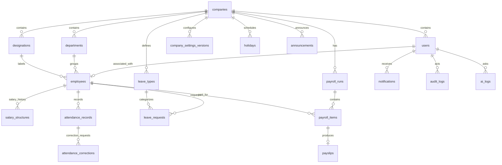

# HCM Lite — Backend Database Schema & Data Dictionary

**Status:** Implementable **[PROPOSED]** PostgreSQL/Prisma relational data model derived from the source PDF.  
**Source:** Saylani Hackathon HCM Lite brief, especially pp. 2–5.  
**Important:** The brief lists logical datasets and required behaviors but **does not mandate exact tables or fields**. Everything labeled as a table, primary key, `UUID`, index, or relation below is a proposed design, not a quotation from the PDF.

## 1. Data architecture principles

1. **[BRIEF]** No seeded/dummy employees, attendance, leave, payroll, company KPIs or AI answers. First-run creates Admin/company, then real users create data.
2. **[BRIEF]** Three roles and per-user data scope are mandatory on the server.
3. **[BRIEF]** Dates, rules, attendance and salary must feed payroll, dashboards and AI through consistent services.
4. **[BRIEF]** Every employee gets login credentials on registration; temporary password changes at first sign-in.
5. **[BRIEF]** Important actions are audited; finalized payroll is locked; no API permits audit log edits.
6. **[PROPOSED]** Use `UUID` primary keys, UTC database timestamps, explicit `company_timezone` for work dates, `NUMERIC(14,2)` money, and ISO 8601 dates.
7. **[PROPOSED]** Use foreign keys, database unique constraints and transactions to prevent races, leaks and duplication.
8. **[PROPOSED]** Single company in first MVP (the brief's setup is for **the company**); retain `company_id` relation for cleaner grouping, not as a promise of multi-tenant support.
9. **[PROPOSED]** Store historical policy/salary/payroll snapshots where later edits could change older results.

## 2. High-level entity relationship diagram [PROPOSED]



**Note:** These relationships are implementation choices. The official diagram lists users, employees/departments, attendance, leave, payroll/payslips, settings/holidays, audit/AI logs but does not prescribe their exact normalization.

## 3. Table dictionary

Type notation: `uuid`, `text`, `varchar(n)`, `date`, `timestamptz`, `int`, `numeric(14,2)`, `boolean`, `jsonb`. `PK` = primary key; `FK` = foreign key; `UQ` = unique.

### 3.1 `companies` — first-run organization

| Field | Type | Rule |
|---|---|---|
| `id` | uuid PK | New company key |
| `name` | varchar(180) | Required at first run [BRIEF] |
| `timezone` | varchar(64) | [PROPOSED] valid IANA zone, selected during setup |
| `is_initialized` | boolean | [PROPOSED] first-run completion marker |
| `created_at`, `updated_at` | timestamptz | Server-managed |

**Constraint:** For MVP, allow only one company/bootstrap; enforce in first-run transaction. Company name required. [PROPOSED implementation]

### 3.2 `company_settings_versions` — effective office rules

| Field | Type | Rule |
|---|---|---|
| `id` | uuid PK | Policy version |
| `company_id` | uuid FK | Parent |
| `effective_from` | timestamptz | Settings apply to newly created records from this point |
| `office_start_time` | text / SQL time | Default `09:00` [BRIEF] |
| `grace_minutes` | int | Default `15` [BRIEF] |
| `half_day_minutes` | int | Default `300` (under five hours) [BRIEF] |
| `weekend_days` | int[] or jsonb | Initial Sat/Sun [BRIEF] |
| `office_latitude`, `office_longitude` | numeric | Optional for camera bonus, Admin-configured [BRIEF] |
| `office_radius_meters` | int | Example `150` [BRIEF] |
| `changed_by_user_id` | uuid FK | Admin who saved settings |
| `created_at` | timestamptz | Server-managed |

**Key design:** Treat edits as new version rather than overwriting old history. Attendance/leave calculations can refer to settings in force when a record was created. **[PROPOSED]** Historical treatment of subsequently recorded holidays must be explicitly decided.

### 3.3 `users` — access identities

| Field | Type | Rule |
|---|---|---|
| `id` | uuid PK | User ID |
| `company_id` | uuid FK | Company scope |
| `email` | varchar(255) | Required; unique within company; normalized |
| `password_hash` | text | bcrypt hash [BRIEF] |
| `role` | enum | `ADMIN`, `HR`, `EMPLOYEE` [BRIEF] |
| `is_active` | boolean | Admin may deactivate [BRIEF] |
| `must_change_password` | boolean | `true` for new employee/temporary credentials [BRIEF] |
| `password_changed_at` | timestamptz nullable | [PROPOSED] session control |
| `created_by_user_id` | uuid FK nullable | Admin or HR creator |
| `created_at`, `updated_at` | timestamptz | Server-managed |

**Constraints:** `UQ(company_id, lower(email))` via functional DB index; only Admin can create HR users; HR creates EMPLOYEE users through employee-registration service; no route lets HR create ADMIN. [BRIEF]

**Important HR case [OPEN]:** The checklist permits HR to check in and request personal leave. If that is used, an HR user also needs an employee profile linked through `employees.user_id`; require this association for HR self-service flows instead of pretending HR has an employee ID automatically.

### 3.4 `departments` and `designations`

| Table | Required fields [PROPOSED] | Constraints |
|---|---|---|
| `departments` | `id`, `company_id`, `name`, `code?`, `is_active`, timestamps | Unique company/name or code; Admin CRUD |
| `designations` | `id`, `company_id`, `name`, `is_active`, timestamps | Unique company/name; Admin CRUD |

**[BRIEF]** HR can view catalogs and select existing department/designation when onboarding, not modify the catalogs.

### 3.5 `employees` — Employee 360

| Field | Type | Rule |
|---|---|---|
| `id` | uuid PK | Employee identity |
| `company_id` | uuid FK | Organization |
| `user_id` | uuid FK UQ | Linked login account |
| `employee_code` | varchar(30) | Unique within company [BRIEF] |
| `first_name`, `last_name` | varchar(100) | [PROPOSED] required name fields |
| `work_email` | varchar(255) | Valid/unique [BRIEF] |
| `phone`, `address` | text nullable | Employee may edit own only [BRIEF] |
| `department_id`, `designation_id` | uuid FK | Reference Admin catalog [BRIEF] |
| `join_date` | date | ISO date [BRIEF] |
| `end_date` | date nullable | Needed for proration/attrition [BRIEF implication] |
| `employment_status` | enum | [PROPOSED] `ACTIVE`, `PROBATION`, `EXITED`, `INACTIVE` |
| `gender` | enum/text nullable | [PROPOSED] to support Admin gender chart |
| `created_at`, `updated_at` | timestamptz | Server-managed |

**Constraints:** unique `(company_id, employee_code)`, `(company_id, lower(work_email))`; join <= end if present; no salary in employee-owned update payload.

**[OPEN]** The brief does not specify gender vocabulary, minimum required personal info, manager hierarchy, probation dates, or exact meaning of 'inactive'. Collect the minimum needed for judging and do not expose sensitive fields unnecessarily.

### 3.6 `salary_structures` — effective salary history

| Field | Type | Rule |
|---|---|---|
| `id` | uuid PK | Compensation version |
| `employee_id` | uuid FK | Salary owner |
| `effective_from`, `effective_to` | date | Salary applicable to period [PROPOSED] |
| `basic_salary` | numeric(14,2) | >0 [BRIEF] |
| `hra_rate` | numeric(5,4) | Default `0.4000` [BRIEF] |
| `medical_rate` | numeric(5,4) | Default `0.1000` [BRIEF] |
| `created_by_user_id` | uuid FK | HR manager |
| `created_at` | timestamptz | Timestamp |

**Formulas:** `hra = basic × 0.40`, `medical = basic × 0.10`, `gross = basic × 1.5` per PDF. **[OPEN]** Whether HR may override allowance percentages is unclear; prevent overrides in baseline to preserve PDF calculations, or get explicit sign-off.

**Constraint [PROPOSED]:** No overlapping active effective date ranges for the same employee.

### 3.7 `leave_types` and `holidays`

| Table | Proposed fields | Brief business rule |
|---|---|---|
| `leave_types` | `id`, `company_id`, `code`, `name`, `annual_quota_days nullable`, `is_paid`, `is_active`, `created_at` | Annual 14; Sick 8; Casual 10; Unpaid unlimited as initial Admin policy configuration |
| `holidays` | `id`, `company_id`, `date`, `name`, timestamps | Skip when counting leave working days |

**Constraint [PROPOSED]:** unique holiday company/date; unique leave type code per company; `annual_quota_days = NULL` means unlimited only for unpaid under current policy.

**Historical settings caution:** If Admin changes quota, clarify effective-year treatment; do not retroactively rewrite approved leave without a recorded business policy. [BRIEF: settings apply to new records only]

### 3.8 `attendance_records` — one row per employee-day

| Field | Type | Rule |
|---|---|---|
| `id` | uuid PK | Attendance record |
| `employee_id` | uuid FK | Record owner |
| `work_date` | date | Company-local date |
| `check_in_at` | timestamptz | **Server timestamp** [BRIEF] |
| `check_out_at` | timestamptz nullable | **Server timestamp** [BRIEF] |
| `worked_minutes` | int nullable | Derived after valid checkout [PROPOSED] |
| `source` | enum | `WEB`, optional `CAMERA` [BRIEF] |
| `was_late` | boolean | Evaluated using effective schedule [PROPOSED representation] |
| `was_half_day` | boolean | Evaluated after checkout [PROPOSED representation] |
| `has_missing_checkout` | boolean | True without checkout [PROPOSED representation] |
| `settings_version_id` | uuid FK | Freeze applicable attendance policy [PROPOSED] |
| `geofence_result_json` | jsonb nullable | Bonus detection/location outcome only [PROPOSED] |
| `created_at`, `updated_at` | timestamptz | Audited |

**Critical unique constraint:** `UQ(employee_id, work_date)`. Enforce transactionally; map duplicate insert to `409 Conflict` [BRIEF]. Validate `check_out_at >= check_in_at` except explicit controlled correction; do not accept client-supplied timestamps for direct check-in/out.

**`absent` is a calculated employee-working-day status** when no attendance and no approved leave [BRIEF]. **[PROPOSED]** Generate on analytics/payroll date expansion rather than inserting fake check-in records for absenteeism.

**[OPEN]** Status priority where late, half-day and missing_checkout flags collide; retain flags and define a normalized reporting projection.

### 3.9 `attendance_corrections` — audited correction workflow

| Field | Type | Rule |
|---|---|---|
| `id` | uuid PK | Correction request |
| `employee_id` | uuid FK | Requester subject |
| `attendance_record_id` | uuid FK nullable | May be null for missing-day request [PROPOSED] |
| `target_work_date` | date | Requested date |
| `proposed_check_in`, `proposed_check_out` | timestamptz nullable | Requested adjustment [PROPOSED] |
| `reason` | text | Required [BRIEF] |
| `status` | enum | `PENDING`, `APPROVED`, `REJECTED` |
| `requested_by_user_id` | uuid FK | Employee actor |
| `decided_by_user_id`, `decided_at` | uuid FK/timestamptz nullable | HR decision |
| `decision_comment` | text nullable | Reviewer explanation [PROPOSED for consistent review] |
| `created_at` | timestamptz | Submitted time |

**Behavior:** On approval, service applies correction and writes before/after audit event in a transaction. Employee never directly PATCHes attendance records. [BRIEF]

### 3.10 `leave_requests` — leave history, not fabricated balances

| Field | Type | Rule |
|---|---|---|
| `id` | uuid PK | Leave request |
| `employee_id` | uuid FK | Self-service owner |
| `leave_type_id` | uuid FK | Leave catalog |
| `start_date`, `end_date` | date | Inclusive interval [PROPOSED] |
| `chargeable_days` | numeric(6,2) | Days excluding working off-days/holidays [BRIEF] |
| `reason` | text | Reason captured, including smart-leave user-confirmed form |
| `status` | enum | `PENDING`, `APPROVED`, `REJECTED`, `CANCELLED` |
| `requested_by_user_id` | uuid FK | HR/Employee owner |
| `decision_comment` | text nullable | Approval/rejection comment [BRIEF] |
| `decided_by_user_id`, `decided_at` | uuid FK/timestamptz nullable | HR decision |
| `cancelled_at` | timestamptz nullable | Owner cancellation |
| `policy_snapshot_json` | jsonb nullable | Applicable quota/calendar policy [PROPOSED] |
| `created_at`, `updated_at` | timestamptz | Times |

**Behavior:** overlapping or over-quota request yields `422` [BRIEF]. The approved consumption of annual, sick and casual leave is calculated from **approved chargeable days**, by calendar year and type. Unpaid is unlimited but still drives pay deduction.

**Derived balance (preferred [PROPOSED]):** `remaining = applicable_year_quota − SUM(approved_chargeable_days)`; no writable "current leave balance" number that can drift out of sync. **[OPEN]** Pending reservations, year crossings, carryovers and cancellation-after-approval rules must be formally decided. Use a transaction/advisory lock to avoid simultaneous leave requests overspending quota.

### 3.11 `payroll_runs` — monthly batch and lock

| Field | Type | Rule |
|---|---|---|
| `id` | uuid PK | Payroll month identity |
| `company_id` | uuid FK | Company |
| `period_year`, `period_month` | int | Selected calendar payroll month |
| `status` | enum | `DRAFT`, `FINALIZED` [BRIEF] |
| `created_by_user_id` | uuid FK | HR draft creator |
| `finalized_by_user_id` | uuid FK nullable | Admin only |
| `finalized_at` | timestamptz nullable | Lock time |
| `calculation_rules_json` | jsonb | Rates/tax settings snapshot [PROPOSED] |
| `gross_total`, `tax_total`, `deduction_total`, `net_total` | numeric(14,2) | Server-computed totals |
| `created_at`, `updated_at` | timestamptz | Audit timestamps |

**Constraint:** `UQ(company_id, period_year, period_month)` for one canonical payroll run per month [PROPOSED]. Reject any write if `status = FINALIZED`. Lock the parent row during finalization to prevent concurrent update/finalize race.

### 3.12 `payroll_items` — exact employee-level calculation snapshot

| Field | Type | Rule |
|---|---|---|
| `id` | uuid PK | Payroll line item |
| `payroll_run_id` | uuid FK | Parent month |
| `employee_id` | uuid FK | Employee |
| `salary_structure_id` | uuid FK | Salary policy used |
| `eligible_working_days`, `absent_days`, `unpaid_days`, `half_days` | numeric(6,2) | Inputs to deduction, from actual records |
| `basic`, `hra`, `medical`, `gross` | numeric(14,2) | Salary components |
| `proration_amount` | numeric(14,2) | Join/exit treatment [PROPOSED field] |
| `absence_deduction`, `income_tax`, `net` | numeric(14,2) | Calculated amounts |
| `calculation_breakdown_json` | jsonb | Explanation and pay inputs [PROPOSED] |
| `created_at` | timestamptz | Generated time |

**Constraints:** `UQ(payroll_run_id, employee_id)`; require status check before changes. **[OPEN]** Monthly tax allocation, rounding and proration order require agreed rules before coding.

### 3.13 `payslips` — available only after finalization

| Field | Type | Rule |
|---|---|---|
| `id` | uuid PK | PDF payslip |
| `payroll_item_id` | uuid FK UQ | One payslip per employee/run item |
| `generated_at` | timestamptz | Generation timestamp |
| `pdf_storage_key` | text nullable | Optional file storage [PROPOSED] |
| `checksum` | text nullable | Optional PDF integrity metadata [PROPOSED] |

**[BRIEF]** Admin/HR can view all; Employee can only download own payslip. **[PROPOSED]** Generate PDF on request from immutable finalized snapshot, with optional cached file key. Never expose a predictable public file URL without authorization.

### 3.14 `announcements` and `notifications`

| Table | Proposed fields | Access |
|---|---|---|
| `announcements` | `id`, `company_id`, `title`, `body`, `posted_by_user_id`, `published_at`, timestamps | Admin/HR create; all roles read [BRIEF] |
| `notifications` | `id`, `user_id`, `type`, `title`, `message`, `entity_type`, `entity_id`, `read_at`, `created_at` | Own recipient only [BRIEF] |

**Notification types [PROPOSED]:** `LEAVE_APPROVED`, `LEAVE_REJECTED`, `PAYSLIP_READY`, `GENERAL`. Server must ensure notification recipient matches event subject.

### 3.15 `audit_logs` — append-only sensitive action history

| Field | Type | Rule |
|---|---|---|
| `id` | uuid PK | Event key |
| `company_id` | uuid FK | Company |
| `actor_user_id` | uuid FK nullable | Who made change |
| `action` | varchar(100) | e.g. `LEAVE_APPROVED`, `PAYROLL_FINALIZED` |
| `entity_type`, `entity_id` | text/uuid | Affected record |
| `before_json`, `after_json` | jsonb nullable | Before/after, redacted [BRIEF] |
| `occurred_at` | timestamptz | Timestamp |
| `request_id` | text nullable | Trace [PROPOSED] |

**[BRIEF]:** log important create/update/approve/finalize actions. Admin may view only; **nobody can edit/delete log records**. **[PROPOSED]:** DB grants/append-only permissions or trigger, plus no update/delete endpoints. Never store passwords, access tokens or raw AI keys in before/after JSON.

### 3.16 `ai_logs` — safe interaction record

| Field | Type | Rule |
|---|---|---|
| `id` | uuid PK | Interaction |
| `company_id`, `user_id` | uuid FK | Actor/scope |
| `feature` | enum | `CHAT`, `DASHBOARD_SUMMARY`, `SMART_LEAVE`, `POLICY_QA` [PROPOSED] |
| `tool_names` | jsonb | Tools invoked [PROPOSED] |
| `status` | enum | `SUCCESS`, `REFUSED`, `FALLBACK`, `TIMEOUT`, `ERROR` [PROPOSED] |
| `duration_ms` | int nullable | Request duration |
| `created_at` | timestamptz | Used for per-user/hour throttling |
| `safe_input_excerpt`, `safe_output_excerpt` | text nullable | Optional redacted summaries [PROPOSED] |

**[BRIEF]:** log each AI call, 15s provider timeout, roughly 20 calls per user per hour, `AI-generated` answer label. Never store API keys. Request text can contain salary/personal details, so default to metadata-only logs unless explicitly necessary.

## 4. Required enumerations [PROPOSED vocabulary]

```text
UserRole          ADMIN | HR | EMPLOYEE
EmployeeStatus    ACTIVE | PROBATION | EXITED | INACTIVE
AttendanceSource  WEB | CAMERA
CorrectionStatus  PENDING | APPROVED | REJECTED
LeaveStatus       PENDING | APPROVED | REJECTED | CANCELLED
PayrollStatus     DRAFT | FINALIZED
AINotification    LEAVE_APPROVED | LEAVE_REJECTED | PAYSLIP_READY | GENERAL
```

**Do not use one exclusive AttendanceStatus enum without separate flags**, until precedence between `late`, `half_day`, `missing_checkout`, and `absent` is decided. The brief lists these statuses but doesn't explain every overlap combination.

## 5. Essential indexes and constraints

| Table | Index / constraint [PROPOSED] | Why |
|---|---|---|
| `users` | unique `(company_id, lower(email))` | No duplicate logins |
| `employees` | unique `(company_id, employee_code)`, unique work email | CSV/registration checks |
| `attendance_records` | unique `(employee_id, work_date)` | Mandatory one check-in/day + HTTP 409 |
| `attendance_records` | `(work_date, employee_id)` | Boards and KPI scans |
| `attendance_corrections` | `(status, created_at)` | HR approval inbox |
| `leave_requests` | `(employee_id, status, start_date, end_date)` | Overlap and quota checks |
| `leave_requests` | `(status, created_at)` | HR approval inbox |
| `holidays` | unique `(company_id, date)` | Unique calendar dates |
| `payroll_runs` | unique `(company_id, period_year, period_month)` | Monthly lock identity |
| `payroll_items` | unique `(payroll_run_id, employee_id)` | One item/employee/run |
| `notifications` | `(user_id, read_at, created_at)` | Per-user feed |
| `audit_logs` | `(company_id, occurred_at)` | Admin audit timeline |
| `ai_logs` | `(user_id, created_at)` | Hourly AI request counting |

**Races:** Check-in uniqueness must rely on DB constraint, not only a pre-query; leave approval and payroll finalization require transactions/row locking.

## 6. Access scopes enforced in queries

```text
AuthenticatedRequest = { userId, companyId, role, employeeId? }

ADMIN:
  Can read all employee, attendance, leave, payroll and payslip records.
  May manage setup, user login lifecycle and finalize payroll.
  Cannot edit finalized payroll or audit log rows.

HR:
  Can read/manage HR-operational employees, attendance decisions, leave decisions,
  salary structures and payroll DRAFTs.
  Cannot change company setup, create Admin, finalize payroll or read audit logs.
  Own check-in/leave requires linked HR employee profile.

EMPLOYEE:
  WHERE employees.user_id = authenticated.userId
  All attendance, leave, salary/payslip, personal analytics APIs
  enforce identity before returning data.
  Profile PATCH permits only own phone/address.
```

**AI uses identical scopes** via service functions. Querying `employee_id` supplied by browser is never sufficient proof of ownership.

## 7. Derived views/services (not new source-of-truth tables)

- `daily_employee_work_status`: Expected scheduled date → approved leave? → attendance record? → classify present/late/half-day/missing/absent. Prevent double-counting flags.
- `employee_leave_balance`: Quota/type/year minus approved charged days; respect unlimited unpaid.
- `hr_kpi_summary`: Headcount, daily status, pending approvals, trends, late leaderboard.
- `admin_kpi_summary`: Headcount, attrition, payroll cost, mean gross, department/gender/tenure series.
- `personal_kpi_summary`: Weekly hours versus 40, late count, own leave and latest payslip.
- `payroll_preview`: Deterministic itemized calculation from locked rule/salary/attendance inputs.

**Rule:** Dashboards and AI ask the same service layer for these aggregates, not separate front-end arithmetic. [BRIEF]

## 8. State consistency and transactions

**Employee registration:** write `users`, `employees`, `salary_structures`, and audit event as one unit; on failure roll back all changes.  
**Attendance check-in:** unique daily insert with server timestamp; error `409` on unique violation.  
**Leave approval:** transactionally verify request still pending, quota constraints, set approved, write audit event and notification.  
**Payroll creation:** HR creates a DRAFT snapshot, preventing duplicate same-month runs.  
**Payroll finalization:** lock run, assert still DRAFT and current actor ADMIN, finalize atomically, prevent all subsequent edits, queue payslip notifications.

## 9. Data storage and privacy considerations

- Never store passwords, AI credentials, access tokens or raw secrets in readable fields.
- Prefer no face photo storage in optional attendance; store minimal detection result per PDF, with transparent notice.
- Define archival/deletion policy for personal records **[OPEN]**; the brief does not provide a retention duration.
- Audit outputs must avoid leaking full salary/PII indiscriminately; restrict to Admin and redact secrets.
- Server side validates role/data scope even when user guesses another employee's record UUID.
- Exports are HR-only; protect downloadable generated files by authorization and short-lived delivery.

## 10. Schema verification checklist

- [ ] Fresh migration contains **zero** operational company/user/employee rows (until first Admin setup).
- [ ] Bootstrap creates no demo employees or mocked activity.
- [ ] Employee add creates corresponding login and salary structure transactionally.
- [ ] Employee access cannot read any other employee's payroll/leave/attendance.
- [ ] Second daily check-in returns HTTP 409 via unique constraint.
- [ ] Leave overlap/balance rejects with HTTP 422.
- [ ] Payroll stores exact per-employee, per-period calculation snapshots.
- [ ] Finalized run cannot be mutated even by Admin.
- [ ] Every important action produces immutable audit event.
- [ ] AI answers and KPI endpoints query the same actual aggregates.
- [ ] Unspecified policies/time zones/rounding are documented as decisions, not claimed as PDF facts.

**Source trace:** Brief p. 2 rule/permission tables; p. 3 AI logs/camera; p. 4 data/system diagrams; p. 5 metrics and function checklist.
