# HCM Lite — Implementation Plan, Milestones & Acceptance Gates

**Planning stage only — no implementation prompts or application code in this deliverable.**  
**Based on:** Saylani HCM Lite challenge brief, 24 October 2026.  
**Source constraint:** A web app, 25 functionalities across 9 modules, 3 roles, real-only data, server-scoped AI, 5-minute live demo, and judge-ready README are required. Camera/mobile and listed enhancements are optional bonuses.

## 1. Planning approach

**Strategy:** Build a real, testable **end-to-end vertical slice** first, then expand. Do not implement AI chat before deterministic backend business services or fabricate metrics in the UI.

### Recommended milestone sequence

```mermaid
flowchart LR
  A[0 Docs + decisions] --> B[1 Skeleton + DB]
  B --> C[2 Bootstrap/Auth/Setup]
  C --> D[3 Employees]
  D --> E[4 Attendance]
  E --> F[5 Leave]
  F --> G[6 Payroll]
  G --> H[7 Analytics]
  H --> I[8 AI]
  I --> J[9 Comms/Audit]
  J --> K[10 QA/Deploy/Demo]
  K -.if core passes.-> L[11 Bonuses]
```



### What is source requirement vs team choice?

- **[BRIEF]** 9 modules, 25 features, permissions, business rule numbers, demo, hosted app, scoring.
- **[PROPOSED]** React/Express/Postgres stack, route names, database tables, wireframes and exact milestone order.
- **[OPEN]** payroll tax/monthly rounding, status precedence, KPI denominator, leave cancellation policy, time zone; settle these before dependent modules.

## 2. Roles and four-person work split [PROPOSED]

The PDF describes a four-person team: **two backend developers and two frontend developers**. [BRIEF, p. 1]

| Team member | Main ownership | Partner/backup |
|---|---|---|
| Backend A | Authentication, setup, employee APIs, permission guard, schema/migrations | Backend B reviews permissions |
| Backend B | Attendance, leave, payroll, analytics and AI service wiring | Backend A reviews calculations |
| Frontend A | Shared shells, design system, Admin + HR screens | Frontend B reviews responsive UX |
| Frontend B | Employee self-service, charts, smart leave/chat integration | Frontend A reviews shared state |

**Integration ritual:** Each module merges only when FE API contract, backend validation, role checks, empty state and an end-to-end happy path are all verified. [PROPOSED]

## 3. Phase 0 — Planning freeze (CURRENT PHASE)

**Inputs:** official PDF and these six Markdown planning documents.  
**Tasks:**

- [ ] Confirm one-page project scope: **must-have**, **explicit bonus**, **open decisions**.
- [ ] Review all 25 requirements in `01_PRD.md`; assign functional owner per ID.
- [ ] Review HR/Admin/Employee action matrix and potential inconsistencies.
- [ ] Sign off stack, project folders, environment variables, deployment destination.
- [ ] Decide rules for status collisions, KPI denominator, leave year, payroll monthly tax/rounding and company timezone.
- [ ] Agree screen/navigation inventory in `03_APP_FLOW.md` and responsive direction in `04_UI_UX_BRIEF.md`.
- [ ] Agree schema and indexes in `05_BACKEND_SCHEMA.md`; create versioned migrations only in implementation phase.
- [ ] Prepare separate API contract, RBAC matrix, business-rules reference and test cases as recommended supporting docs.

**Acceptance gate G0:** Team can explain a complete journey, technical ownership and all [OPEN] issues; no code is generated until critical decisions are recorded.

## 4. Phase 1 — Repository, database, backend/front-end skeleton

**Functional preparation:** shared project structure, local DB, env contract, typed API client, lint/test scripts, continuous integration if desired.

- [ ] Create `apps/web`, `apps/api`, `docs`, `README.md`, `.env.example`.
- [ ] Set up linting, formatting, shared TypeScript types, error format, `health` API.
- [ ] Provision relational database and initial schema migration; ensure no employee/activity seeds.
- [ ] Add password hashing utility, JWT verification middleware, role/scope authorization middleware.
- [ ] Build layout and empty/loading/error primitives, not sample KPI widgets.
- [ ] Wire development/prod frontend API URL configuration and CORS allowlist.

**Gate G1:** Local web reaches live API/DB; a fresh install contains no company or HR operational records; tests run cleanly.

## 5. Phase 2 — M1 Authentication + M2 Organization setup (F01–F05)

**Backend A:** first-run transaction/lock, company+Admin identity, JWT/bcrypt, forced temporary password rotation, Admin HR-account lifecycle, organization settings versions, department/designation/leave policy/holiday services, audit event helpers.

**Frontend A:** first-run wizard, Admin setup checklist, login/reset/change password, role navigation shells, settings and catalog forms, user account page.

**Minimum acceptance tests:**

- [ ] Fresh database shows first-run setup; Admin creation succeeds once.
- [ ] Config defaults 09:00/15min/Sat–Sun/<5h and leave quotas 14/8/10/unlimited are applied to setup configuration.
- [ ] Admin can create HR login; HR cannot change company settings or create Admin.
- [ ] Employee first-login password change blocks other activity until completed.
- [ ] Deactivated user cannot access protected APIs.
- [ ] Role-specific menus **and** API permission checks work.

**Gate G2:** Admin can configure company and sign in/out as HR with proper separation.

## 6. Phase 3 — M3 Employee management (F06–F08)

**Backend A:** employee+user+salary transaction, `employee_code`/email uniqueness, directory search/filter/pagination, 360 profile, own profile contact patch, CSV dry-run row/field/reason, commit/export.

**Frontend A+B:** employee form, profile tabs, directory table/filters, CSV review screen and validation issues table.

**Minimum acceptance tests:**

- [ ] HR registers 2–3 real employees with jobs and salary; creates real logins.
- [ ] Employee logs in with initial credential and changes password.
- [ ] HR can find employees with server-side query and filters.
- [ ] Employee edits only own phone/address, not role, salary or other people.
- [ ] CSV dry run writes nothing; reports malformed email/date, missing department, salary <=0, duplicate code/email.
- [ ] HR export works; Admin/Employee CSV import controls/API calls denied.

**Gate G3:** Employee onboarding and authorized directory are fully functional with empty and populated data.

## 7. Phase 4 — M4 Attendance (F09–F11)

**Backend B:** server timestamp check-in/out, unique employee-day constraint → HTTP 409, late/half-day/missing classification, daily board, employee calendar, correction submission and HR approval.

**Frontend B:** check-in/out widget, calendar, correction form, status messages.  
**Frontend A:** HR daily board and correction inbox.

**Minimum acceptance tests:**

- [ ] Employee and properly linked HR employee can check in/out for self.
- [ ] Check-in at/default before 09:15 versus after 09:15 classified as specified.
- [ ] Work duration under 5h = half-day; missing checkout flagged; workday with no attendance/leave becomes absent in derived report.
- [ ] Duplicate same-day check-in returns 409 and does not create second row.
- [ ] Employee requests correction; HR approves/rejects; employee cannot directly change timestamps.
- [ ] Admin/HR overview versus Employee personal scope enforced.

**Gate G4:** Attendance record changes are visible consistently in employee view and HR dashboard projections.

## 8. Phase 5 — M5 Leave management (F12–F13)

**Backend B:** leave types/quotas, holiday/weekend date counter, overlap detection, balance check (422), pending request, HR approval/rejection with comment, cancellation, transactional leave balance, notifications.

**Frontend B:** leave balances, application form and history.  
**Frontend A:** approval queue, decision dialog and reason/status display.

**Minimum acceptance tests:**

- [ ] Annual 14, sick 8, casual 10, unlimited unpaid are used from Admin configuration.
- [ ] Saturday, Sunday, and holidays excluded from chargeable days.
- [ ] Overlap/over-quota submission returns 422 with useful error.
- [ ] Pending request does not falsely appear approved; HR approves with comment.
- [ ] Approved leave appears in balances, attendance exclusions and HR summaries.
- [ ] Employee cannot approve own leave or view others' confidential requests.

**Gate G5:** Real end-to-end request → HR decision → updated balance + notification.

## 9. Phase 6 — M6 Payroll Lite (F14–F17)

**Backend B:** salary effective history, period workday count, joiner/leaver proration, absent/unpaid/0.5 half-day deductions, five specified illustrative tax bands, item snapshots, HR monthly draft, Admin-only finalization and locking, PDF generation.

**Frontend A:** salary editor, payroll draft list/detail and employee breakdown.  
**Frontend B:** employee payslip list/download.  
**Shared:** Admin finalization confirmation.

**Minimum acceptance tests:**

- [ ] Salary formula computes gross = 1.5 × basic, HRA 40%, medical 10%.
- [ ] Payroll period reads **actual** salary, absence, approved unpaid leave, and half-day data.
- [ ] Month proration handles joiner/leaver edge cases.
- [ ] Illustrative tax slab boundaries and approved monthly-tax interpretation pass tests.
- [ ] HR creates/reviews but **cannot** finalize.
- [ ] Admin finalizes; neither HR nor Admin can update finalized item/payroll.
- [ ] Employee can download only own **finalized** payslip PDF.

**Gate G6:** Judges can observe a complete payroll cycle from attendance and leave to a locked payslip.

## 10. Phase 7 — M7 Dashboards & Analytics (F18)

**Backend B:** standard KPI definitions, company-local date calendar, expected workdays, department filters, role-specific aggregation endpoints, trend series and top-late list. Ensure formula consistency and zero-data handling.

**Frontend A+B:** Admin dashboard and HR board; Employee personal metrics; server-filtered charts; skeleton/empty/error states.

**Minimum acceptance tests:**

- [ ] HR today cards: headcount/present/on leave/late/pending match transactions.
- [ ] Admin headcount, YTD attrition, gross/net payroll by department, average salary calculated accurately.
- [ ] Employee weekly hours versus 40, own leave and payslip match personal records.
- [ ] Charts and tables recompute on date/department changes.
- [ ] No fake chart lines or constant numbers are embedded in production UI.
- [ ] Status overlaps do not inflate KPI counts; denominator decision is documented.

**Gate G7:** Dashboard stats can be independently reproduced with created judge test records.

## 11. Phase 8 — M8 AI Assistant (F19–F22)

**Backend B (with A security review):** hosted API integration, `POST /ai/chat`, seven required function/tool adapters, role-scoped execution via existing services, dashboard insight generator from current KPI JSON, smart leave JSON validation+single retry, policy Q&A, 15-second timeout, about 20 calls/user/hour, `ai_logs`.

**Frontend B:** role-aware AI chat, suggested question chips based on allowable data, AI-generated labels, smart leave pre-fill/confirmation, friendly fallback.  
**Frontend A:** Admin/HR dashboard Summarize interactions.

**Minimum acceptance tests:**

- [ ] HR asks active headcount and late ranking, gets same values as dashboard.
- [ ] Employee asks own sick balance, gets correct approved-leave subtraction.
- [ ] Employee asks colleague's salary, AI politely refuses; no confidential data sent to LLM.
- [ ] Sentence-based leave suggestion populates type/dates/reason but does not auto-save.
- [ ] Dashboard summary has 3–5 insights using only filtered KPI JSON.
- [ ] Unknown policy, provider timeout and invalid JSON fail safely.
- [ ] AI key is backend-only; AI calls are logged and throttled.

**Gate G8:** AI assists real workflows and passes direct unauthorized-data prompts without leaks.

## 12. Phase 9 — M9 Communication & Audit (F23–F25)

**Backend A:** announcements CRUD/post; notification events on leave decisions/finalized payslips, per-user read state; append-only audit action recorder and Admin-only feed.

**Frontend A+B:** announcement composer/feed, notification center/bell, Admin audit table.

**Minimum acceptance tests:**

- [ ] Admin and HR can post announcements; employees can read, not post.
- [ ] Correct employee sees own leave decision and payslip-ready notification.
- [ ] Audit log shows actor, action, entity and sanitized before/after details.
- [ ] HR and Employee cannot access audit feed.
- [ ] Nobody can update/delete audit entries; finalized payroll writes an audit event.

**Gate G9:** All 25 checklist features have an implementation path and tested permissions.

## 13. Phase 10 — QA, deployment and official live demo

### A. Regression matrix

- [ ] Bootstrap fresh database and create company/HR.
- [ ] Register 2–3 employees and verify initial passwords.
- [ ] Check in/out, leave request, approval and correction workflows.
- [ ] Generate and finalize payroll, download employee-specific payslip.
- [ ] Validate Admin/HR/Employee endpoint scopes, including guessed IDs.
- [ ] Validate chart numbers and corresponding AI answers on same dates/departments.
- [ ] Validate safe AI failures, empty states, 375px responsive layout.
- [ ] Exercise CSV dry run, imports/export, announcements, notifications and audit feed.
- [ ] Review audit and AI logs for accidental secrets/PII.

### B. Deploy deliverables [BRIEF]

- [ ] Public or judge-shared Git repository with readable history.
- [ ] Hosted frontend and backend; configured database.
- [ ] Secure `AI_API_KEY`, `DATABASE_URL`, `JWT_SECRET` in hosting env only.
- [ ] Commit **only `.env.example`**, not `.env`.
- [ ] README: stack, installation, run commands, fresh Admin bootstrap, AI key setup, completed/incomplete items, hosted URL.
- [ ] Verify judge follows README and can bring it up **within 10 minutes**.
- [ ] Each student submits repository link and hosted app link at `https://lms.saylaniit.com/`.

### C. Five-minute demo script [BRIEF]

| Order | Demo action | Proof |
|---|---|---|
| 1 | Open fresh installation; Admin configures company, hours/location, department, leave types; creates HR login | Real bootstrap; empty database |
| 2 | HR registers 2–3 employees; one changes password and checks in | Employee and attendance E2E |
| 3 | Employee types plain-language leave; reviews suggested form; submits; HR approves | Smart leave + approval |
| 4 | HR checks dashboard, requests AI summary and who-is-on-leave answer | Same real records in AI + KPIs |
| 5 | HR prepares payroll; Admin finalizes | Enforced role and locked month |
| 6 | Employee downloads payslip, asks for colleague salary and is refused; Admin shows audit log | Payroll/AI security/auditing |

The PDF lists these demonstration actions as a sequence, not exact second-by-second timing. Rehearse them within the required overall five-minute slot.

**Gate G10:** Hosted project passes the complete sequence from a newly initialized company without altering raw DB values manually.

## 14. Phase 11 — Optional bonus enhancements (only after core passes)

The PDF offers **up to +10 bonus points** for: camera attendance with face detection + location, attrition risk score, absence anomaly flags, late penalty (three lates = half-day), Roman Urdu AI, dark mode/PWA. Mobile app itself is optional. [BRIEF, p. 5]

**Recommended order [PROPOSED]:**

1. **Responsive web camera attendance + geofence** (bonus feature in required web app, no separate mobile build prerequisite): exactly one face, GPS accuracy <=100m, server Haversine distance, Admin-defined radius, no photo by default, correction fallback.
2. **Roman Urdu questions** without relaxing AI tool permissions.
3. **Dark mode / PWA**, if no core regressions.
4. **Attendance anomaly flag and late penalty**, but only if policy conflicts/analytics/payroll implications are signed off.
5. **Attrition risk score**, only if sufficient real data and transparent rationale.

**Do not put any of these in the must-have acceptance criteria.** They are optional.

## 15. Official scoring → prioritization table

| Evaluation criterion | Points | Highest-value demonstration |
|---|---:|---|
| Core HR flows | 25 | F01–F17 operate end to end |
| Data & analytics | 20 | Dashboard numbers match live DB + filters |
| AI features | 15 | Correct tools, refusal, smart leave, graceful failure |
| Code quality | 15 | Services, typed validation, domain unit tests |
| UI / UX | 10 | Role-specific clean screens, mobile responsiveness, empty states |
| Security & RBAC | 10 | Server-side scope guard, bcrypt, server-only AI key, audit log |
| Demo & docs | 5 | 5-minute story, live URL, runnable README |
| **Core** | **100** | |
| Bonus | **+10** | Optional after complete core |

## 16. Risk register and mitigations [PROPOSED]

| Risk | Impact | Mitigation |
|---|---|---|
| AI gives invented headcount | Fails live judging | Use backend tools + same KPI service; test against exact DB fixture data |
| Unscoped salary or payslip API | Security failure | Centralized role/data guards + cross-ID access tests |
| Approval races overdraw leave | Wrong balance/payroll | Transactional check + unique/lock strategy |
| Duplicate attendance records | Wrong pay and charts | DB unique `(employee_id, work_date)` + HTTP 409 |
| Payroll value changes after finalize | Breaks immutable payslips | Snapshots; DB transaction + hard lock checks |
| Setting changes corrupt history | KPI/payroll drift | Version policy applied to new records only |
| CSV bypasses employee validation | Corrupt employee database | Share single per-row Zod/domain validator with registration service |
| No-data screens show mock KPIs | Violates key PDF rule | Never ship seeded/mock production records |
| Poor README causes judge setup failure | Scoring loss | Rehearse from clean clone and env example |
| Bonus consumes time ahead of MVP | Incomplete core flows | Explicit G10 core pass before phase 11 |

## 17. Traceability and ownership tracker

Use this compact master checklist; each item must have an actual test and a verifiable UI path before marked complete.

```text
[ ] F01 First-run Admin/company
[ ] F02 Login/logout/password, role dashboards
[ ] F03 Company office rules/geofence
[ ] F04 Departments/designations/leave/holidays
[ ] F05 Admin-managed HR accounts
[ ] F06 Employee onboarding/login
[ ] F07 Employee directory/Employee 360
[ ] F08 CSV dry-run/import/export
[ ] F09 Web check-in/out
[ ] F10 Personal calendar + HR board
[ ] F11 Attendance correction approvals
[ ] F12 Leave application/cancellation/balance
[ ] F13 HR leave decision with comment
[ ] F14 Salary structure
[ ] F15 Monthly payroll draft
[ ] F16 Admin finalization/lock
[ ] F17 Payslip PDF
[ ] F18 Role dashboards/KPI filters
[ ] F19 Real-data scoped AI chat
[ ] F20 Filtered AI summary
[ ] F21 Smart leave pre-filled form
[ ] F22 Policy Q&A
[ ] F23 Announcements
[ ] F24 In-app notifications
[ ] F25 Immutable audit log
```

## 18. Recommended follow-on Markdown files

These are **not part of the six currently required files**, but are strongly recommended before the first significant implementation sprint.

| Suggested file | Priority | Why it matters |
|---|---|---|
| `07_API_CONTRACT.md` | HIGH | Exact routes, request/response JSON, error contracts, auth details; parallel FE/BE work |
| `08_RBAC_PERMISSION_MATRIX.md` | HIGH | Every role × API × ownership decision; avoids AI or backend data leaks |
| `09_BUSINESS_RULES_AND_CALCULATIONS.md` | HIGH | Single clear rulebook for attendance, leave, payroll, tax and KPI ambiguity resolutions |
| `10_TEST_PLAN_AND_ACCEPTANCE_CASES.md` | HIGH | Executable cases for all 25 features, edge cases and the judge demo |
| `11_AI_TOOLS_AND_GUARDRAILS.md` | HIGH | Seven tool schemas, model/tool boundary, authorization tests, smart-leave JSON |
| `12_DECISION_LOG.md` | HIGH | Signs off all `[OPEN]` decisions so AI coding agents don't invent policies |
| `13_DEPLOYMENT_AND_README_CHECKLIST.md` | MEDIUM | Local install, `.env.example`, deployment, LMS submissions and clean-room verification |
| `14_DEMO_SCRIPT.md` | MEDIUM | Rehearsed five-minute judge walkthrough, fallback/demo logistics |
| `15_DESIGN_SYSTEM.md` | OPTIONAL | Detailed components, tokens, accessibility and UI states before heavy frontend work |

**Recommendation:** First finalize the six-file baseline, then add the first six **HIGH** files and record decision sign-offs; only then move to project scaffolding and coding prompts.

## 19. Final planning-stage exit criteria

- [ ] Six documents exist in repository and agree on must-have scope.
- [ ] All 25 functions mapped to phase and acceptance test.
- [ ] Authorization consistent across PRD, API and schema.
- [ ] No fabricated operational data policy written into architecture and UX.
- [ ] Payroll, leave, attendance and analytics formulas reviewed for ambiguities.
- [ ] Role dashboards/screens approved at basic wireframe level.
- [ ] Bonus features clearly kept outside mandatory delivery.
- [ ] Team approves start of implementation gate G1.

**Source map:** Brief p. 1 challenge/team; p. 2 access and rules; p. 3 AI/camera; p. 4 architecture/dependencies; p. 5 scoring-relevant 25 features and analytics; p. 6 official demo, scoring, submission.
